  

# 🌐 Awesome Web3 & Decentralized Identity Protocols

  
  
  
  
  

---

## 🎯 Overview & Scope

A curated index of premier **SaaS/Hosted platforms** and **open-source GitHub projects** powering **Web3 & Decentralized Identity Protocols (DID)**, **Self-Sovereign Identity (SSI)**, **W3C Verifiable Credentials (VCs)**, and **Zero-Knowledge (ZK) Attestations**.

Whether you are implementing decentralized identity for Sybil resistance, Sign-In with Ethereum (SIWE / EIP-4361), mobile driver's licenses (mDL / ISO 18013-5), European eIDAS 2.0 digital wallet compliance, or cross-chain privacy credentials, this repository tracks production-grade infrastructure, developer tooling, and research SDKs.

---

## 📑 Table of Contents

- [📊 Sector Overview & Market Dynamics](#-sector-overview--market-dynamics)
- [☁️ SaaS & Hosted Platforms](#️-saas--hosted-platforms)
- [💻 Open-Source GitHub Projects](#-open-source-github-projects)
- [🤝 How to Contribute](#-how-to-contribute)
- [⚖️ Disclaimer](#️-disclaimer)

---

## 📊 Sector Overview & Market Dynamics

The global decentralized identity market is valued at approximately **$6.8 billion to $7.9 billion in 2026** and projected to surge past **$58 billion by 2030** (surpassing a 70%+ CAGR), catalyzed by regulatory mandates such as the EU eIDAS 2.0 digital identity wallet frameworks, mobile driver's license (mDL) rollouts across US states, and escalating enterprise demand for biometric anti-deepfake and Sybil-resistant verification. The sector remains **moderately fragmented** across more than 150 registered DID methods and disparate cryptographic stacks, though rapid standardization around W3C Verifiable Credentials, OpenID4VC, and selective disclosure zero-knowledge primitives is progressively concentrating ecosystem adoption among foundational protocol architectures and unified trust networks.

---

## ☁️ SaaS & Hosted Platforms

The table below catalogs leading managed digital identity, verifiable credential, and authentication SaaS platforms, sorted in descending order by estimated company valuation / funding capitalization.

| 🏢 Platform | 📝 Description | 💰 Pricing (Starting Tier) | 🎁 Free Tier Limit / Free Trial | 📈 Valuation / Total Capitalization |
| :--- | :--- | :--- | :--- | :--- |
| **[Worldcoin / World ID](https://world.org)** | Privacy-preserving biometric proof-of-personhood protocol combining custom Orb hardware authentication with zero-knowledge cryptographic iris-code commitments. | **Free protocol / Pay-per-verification on custom partner tiers** | **Free forever plan** with unlimited World ID user verifications via public developer portal & SDK | **$3.0 Billion Valuation** ($240M–$355M Total Raised; Tools for Humanity) |
| **[Galxe Passport](https://galxe.com)** | Universal Web3 credential data network and soulbound identity passport system enabling users to privately attest KYC, off-chain social standing, and on-chain reputation. | **Starting from $4.99/passport mint fee** (Enterprise API plans custom quoted) | **Free forever plan** for credential holders; developers get 1,000 free credential verification queries/month | **$300 Million Valuation** ($35M+ Total Raised via Series A & Public Token Sale) |
| **[Civic Pass / Civic Auth](https://civic.com)** | On-chain identity verification and embedded Web3 authentication suite issuing non-transferable verification passes for Sybil resistance, DeFi compliance, and age verification. | **Starting at $49/month** (Starter Plan with 1,000 monthly active authentications) | **Free forever plan** supporting up to 250 monthly active users (MAUs) and testnet passes | **$85 Million+ Capitalization** ($57M+ Total Funding via Series A & CVC Token Sale) |
| **[Dock.io (Dock Labs / Truvera)](https://dock.io)** | Hosted verifiable credentials platform and blockchain identity gateway providing no-code credential issuance, fraud-proof verification APIs, and white-label digital wallets. | **Starting at $499/month** (Build Plan for pilot production & up to 10,000 credentials) | **30-day free trial** with unlimited credential issuance and test verifications in sandbox environment | **$60 Million+ Capitalization** ($8.2M ICO/Seed Funding; Public Token Ecosystem) |
| **[Gitcoin Passport](https://gitcoin.co)** | Hosted Sybil-resistance aggregator and decentralized identity scoring protocol verifying unique humanity across 30+ Web2 and Web3 cryptographic stamp providers. | **Free for open-source public goods; Developer API tiers from $0.05/scorer query** | **Free forever plan** for individual users collecting stamps and open-source grant matching rounds | **$45 Million Valuation** ($21.7M Total Raised across Series A & Series B rounds) |
| **[SpruceID Enterprise Trust Suite](https://www.spruceid.com/)** | Managed enterprise digital identity and trust infrastructure powering ISO-compliant mobile driver's licenses (mDLs), OpenID4VP verifiers, and W3C credential registries. | **Starting at $500/month** (Starter Developer Integration Tier for private tenant) | **30-day free trial** with full sandbox access and 500 credential mock issuances/verifications | **$41.5 Million Total Funding** (Series A led by a16z crypto) |
| **[Privado ID Cloud](https://www.privado.id/)** | Hosted enterprise identity platform (formerly Polygon ID) providing cloud wallet onboarding, schema design studios, and zero-knowledge zk-proof verification services. | **Starting at $299/month** (Developer Tier including 5,000 cloud ZK verifications) | **14-day free trial** with access to testnet issuer node, schema builder, and 250 mock proofs | **$25 Million+ Ecosystem Capitalization** (Spun out from Polygon Labs ecosystem) |
| **[Trinsic](https://trinsic.id)** | Enterprise identity acceptance network and cloud API engine connecting businesses to reusable digital IDs, eIDs, mobile driver's licenses, and verifiable credentials. | **Starting at $249/month** (Launch Tier including 1,000 live digital ID verifications) | **Free forever plan** in Developer Sandbox environment with mock providers & fake credentials | **$15 Million Valuation** ($11.8M Total Seed Funding raised) |
| **[Fractal ID](https://fractal.id)** | Web3 identity verification and reusable KYC/KYB compliance infrastructure enabling zero-knowledge credential proofs and AML checks for decentralized apps. | **Starting at €1.50/verification** (Pay-as-you-go developer bundle starting at €99/month) | **Free forever plan** for basic liveness checks and Sybil protection on initial 100 app users | **$12 Million Valuation** ($10.5M Raised via Token Seed & Venture Rounds) |
| **[Quadrata](https://quadrata.com)** | Web3 identity and passport network bringing privacy-preserving KYC, AML, credit score reputation, and country-of-residence checks to EVM smart contracts. | **Starting at $199/month platform license** (+ $2.50 per verified on-chain passport issuance) | **30-day free trial** with full developer testnet SDK access and 250 sandbox mock verifications | **$7.5 Million Seed Capitalization** (Backed by Dragonfly Capital & Franklin Templeton) |
| **[Disco.xyz](https://disco.xyz)** | Cross-chain decentralized identity backpack and verifiable data portability network allowing Web3 users to collect, manage, and verify credentials across wallets. | **Starting at $99/month** (Curator & Issuer Tier with automated batch credential distribution) | **Free forever plan** for personal identity backpacks with up to 50 active credential claims | **$5 Million+ Seed Capitalization** (Backed by Consensys, Polygon & Variant) |

---

## 💻 Open-Source GitHub Projects

The following curated open-source repositories provide foundational libraries, DID resolvers, ZK credential engines, smart contracts, and full-stack SSI runtimes, sorted in descending order by GitHub stargazer count.

- **[iden3/snarkjs](https://github.com/iden3/snarkjs)**   
  JavaScript and WebAssembly execution engine for zk-SNARK proof generation and verification, underpinning decentralized identity attestations in Polygon ID / Privado ID.

- **[decentralized-identity/ion](https://github.com/decentralized-identity/ion)**   
  Production-grade Layer-2 Decentralized Identifier network running on the Sidetree protocol anchored to the Bitcoin blockchain without proprietary tokens.

- **[spruceid/siwe](https://github.com/spruceid/siwe)**   
  Reference implementation of the EIP-4361 Sign-In with Ethereum standard for off-chain web service authentication using Ethereum addresses and ENS profiles.

- **[semaphore-protocol/semaphore](https://github.com/semaphore-protocol/semaphore)**   
  Zero-knowledge membership protocol built with Circom and Solidity, enabling anonymous voting, whistleblowing, and group identity proofs without individual disclosure.

- **[ensdomains/ens-contracts](https://github.com/ensdomains/ens-contracts)**   
  Core smart contracts of the Ethereum Name Service (ENS), mapping human-readable `.eth` names to on-chain addresses, decentralized content hashes, and identity records.

- **[decentralized-identity/universal-resolver](https://github.com/decentralized-identity/universal-resolver)**   
  Decentralized Identity Foundation (DIF) modular driver architecture for discovering and resolving dozens of DID methods (`did:ethr`, `did:ion`, `did:key`, `did:web`, `did:pkh`).

- **[decentralized-identity/veramo](https://github.com/decentralized-identity/veramo)**   
  Modular, plugin-based JavaScript/TypeScript framework for managing DIDs, issuing/verifying W3C VCs, and orchestrating DIDComm v2 messaging across Node.js, browsers, and React Native.

- **[openwallet-foundation/acapy](https://github.com/openwallet-foundation/acapy)**   
  Hyperledger Aries Cloud Agent Python (ACA-Py) — enterprise foundation for building verifiable credential issuers, holders, and verifiers using DIDComm and AnonCreds.

- **[ceramicnetwork/js-ceramic](https://github.com/ceramicnetwork/js-ceramic)**   
  Decentralized event-streaming protocol powering ComposeDB and IDX for user-controlled Web3 profile schemas and composable verifiable data streams.

- **[decentralized-identity/did-jwt](https://github.com/decentralized-identity/did-jwt)**   
  Standardized library for signing and verifying JSON Web Tokens (JWT) and JSON Web Signatures (JWS) encoded with Decentralized Identifiers.

- **[openwallet-foundation/credo-ts](https://github.com/openwallet-foundation/credo-ts)**   
  TypeScript SSI framework (formerly Aries Framework JavaScript) for building mobile identity wallets, cloud agents, OpenID4VC flows, and DIDComm v2 applications.

- **[walt-id/waltid-identity](https://github.com/walt-id/waltid-identity)**   
  Comprehensive open-source Kotlin/JVM identity stack featuring Issuer, Verifier, and Wallet APIs supporting W3C VCs, SD-JWT, mDL, and EU eIDAS 2.0 standards.

- **[ethereum-attestation-service/eas-contracts](https://github.com/ethereum-attestation-service/eas-contracts)**   
  Public-good smart contracts and protocol primitives for generating on-chain and off-chain attestations for identity reputation, credentials, and claims.

- **[uport-project/ethr-did](https://github.com/uport-project/ethr-did)**   
  Lightweight Ethereum DID library and ERC-1056 registry allowing any Ethereum keypair or smart contract address to serve as a valid W3C DID.

- **[spruceid/ssi](https://github.com/spruceid/ssi)**   
  Core Rust library and multi-platform toolkit providing primitives for W3C Verifiable Credentials, DID parsing, OpenID4VP, and ISO 18013-5 mDL processing.

- **[decentralized-identity/web5-js](https://github.com/decentralized-identity/web5-js)**   
  Monorepo for the Web5 JavaScript/TypeScript SDK, providing Decentralized Identifiers (DIDs), Verifiable Credentials (VCs), and Decentralized Web Nodes (DWNs).

- **[LIT-Protocol/lit-js-sdk](https://github.com/LIT-Protocol/lit-js-sdk)**   
  Decentralized threshold cryptography SDK allowing developers to build Programmable Key Pairs (PKP) and conditional access control for Web3 decentralized identity.

- **[PrivadoID/issuer-node](https://github.com/PrivadoID/issuer-node)**   
  Self-hosted core issuer node for the Privado ID ecosystem, providing identity state transitions, Merkle tree management, and ZK credential issuance.

- **[KILTprotocol/kilt-node](https://github.com/KILTprotocol/kilt-node)**   
  Dedicated Polkadot/Substrate blockchain node powering KILT Protocol for issuing verifiable, revocable, and privacy-preserving digital identity credentials (`did:kilt`).

- **[hyperledger-identus/hyperledger-identus](https://github.com/hyperledger-identus/hyperledger-identus)**   
  Linux Foundation SSI platform (formerly Atala PRISM) providing enterprise cloud agents, edge SDKs, and mediators for W3C DIDs and verifiable credentials.

- **[anoncreds/anoncreds-rs](https://github.com/anoncreds/anoncreds-rs)**   
  Rust implementation of Anonymous Credentials (AnonCreds) supporting zero-knowledge selective disclosure, cryptographic accumulator revocations, and predicate proofs.

- **[ontio/ontology-DID](https://github.com/ontio/ontology-DID)**   
  Smart contracts and protocol specification for the ONT ID decentralized identity standard (`did:ont`) on the Ontology public blockchain.

- **[docknetwork/dock-substrate](https://github.com/docknetwork/dock-substrate)**   
  High-throughput Substrate blockchain node specifically tailored for decentralized identity management, DID registrations, and credential revocations.

- **[reclaimprotocol/reclaim-js-sdk](https://github.com/reclaimprotocol/reclaim-js-sdk)**   
  Client JavaScript SDK for Reclaim Protocol, generating zero-knowledge cryptographic proofs of HTTPS web identity data without credential or password leaks.

---

## 🤝 How to Contribute

We welcome additions, fixes, and updates from the Web3 decentralized identity community!

1. 🍴 Fork this repository.
2. 🌿 Create a new feature branch (`git checkout -b feature/add-new-identity-protocol`).
3. ✍️ Add your entry in alphabetical or star-ranked order with accurate links, licensing, and documentation.
4. 🚀 Commit your changes (`git commit -m "feat: add [Project Name]"`).
5. 📬 Open a Pull Request detailing what the protocol solves and its active development status.

---

## ⚖️ Disclaimer

*This list is curated for developer reference, educational analysis, and open research purposes only. Mention of any SaaS product, token, or open-source repository does not constitute financial, investment, or legal endorsement.*
